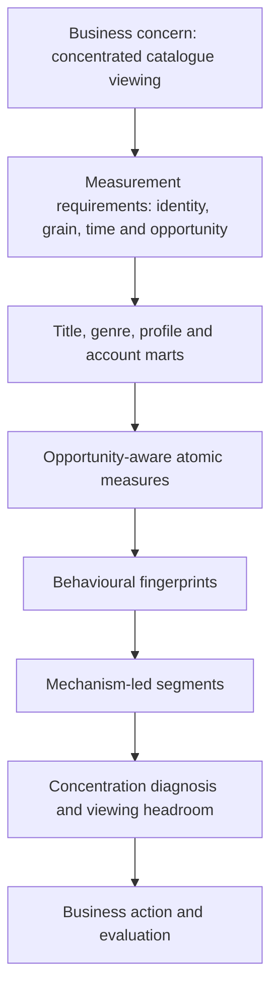

# Analytical framework

**Concentration → mechanism → opportunity** is a sequence of questions, not a composite score.

- **Concentration** describes how attention is allocated.
- **Mechanism** asks which behavioural and access conditions could explain that allocation.
- **Opportunity** asks whether, once those conditions are accounted for, there is credible and observable scope for more viewing.

Answering them in order matters. Asking about opportunity before understanding mechanism is how a platform ends up "fixing" viewers who were perfectly happy.

That sequence has since been extended rather than replaced: **concentration → mechanism → realistic opportunity → opportunity-conditioned propensity → persistence → segments → realisable viewing headroom**.

- Realistic opportunity is reconstructed before behaviour is interpreted (Test 5).
- Cross-origin behaviour carries information the candidate mechanisms do not, so it is retained as a cross-cutting modifier (Test 6).
- Persistence was observed by following the same viewers across both windows (Test 7).
- The final pass verified the advanced population viewer by viewer and formed segments from the historical routes, read by how viewing changed. It then stated, for each segment, the kind of additional viewing its behaviour makes plausible.

Each layer resolves a different uncertainty rather than counting the same evidence twice, and the sequence remains a set of questions rather than a score.

## The measurement bridge

Playback records describe a session, an event and a playable asset. The business diagnosis concerns a viewer, the parent titles they chose, and recurring behaviour under the access they actually had. Those are different units of analysis, and the marts exist to translate between them.



All six marts have been built and semantically reviewed for the uses made of them. The reviews covered:

- the title-level mart;
- the viewer-level base's grain, coverage, activity, session, breadth, concentration and post-choice blocks;
- realistic opportunity;
- cross-origin measurement.

Everything downstream is built on them: the within-profile longitudinal evidence, the mechanism-led segments of the investigated population, and the segment-level account of where additional viewing is plausible. How much additional viewing an intervention would produce is left to controlled testing ([headroom diagnosis](#headroom-diagnosis)).

## The segmentation pathway

```text
CONTEXT / CONSTRAINTS / OPPORTUNITY
        ↓
FAIR ATOMIC MEASUREMENT
        ↓
WINDOW-SPECIFIC BEHAVIOURAL STATES
        ↓
MECHANISM VALIDATION
        ↓
OPPORTUNITY CONDITIONING
        ↓
OPPORTUNITY-CONDITIONED PROPENSITY
        ↓
WITHIN-PROFILE LONGITUDINAL EVIDENCE
        ↓
BEHAVIOURAL FINGERPRINTS
        ↓
MECHANISM-LED SEGMENTS
        ↓
PROSPECTIVE HEADROOM  +  BEHAVIOURAL INCLINATION   (separate judgments)
        ↓
REALISABLE VIEWING HEADROOM
```

Test 7 moved longitudinal evidence ahead of fingerprints: how a configuration recurred and changed across the two windows now informs which measurements a fingerprint should carry, rather than validating a fingerprint after it has been built. Segments then organise viewers by coherent mechanism, and only after that are prospective headroom and behavioural inclination assessed — as two separate judgments, neither of which a segment label settles on its own.

In the final pass the fingerprint stage was realised at route level, not as a score per viewer. Each historical route carries a mechanism signature:

- **attention spread:** individual change in top-title share;
- **kept-title hours:** change in hours on titles meaningful in both windows;
- **the split of hours** between dropped, kept and newly meaningful titles;
- **Baseline hours**, as scale.

Segments collapse routes whose signatures agree. Prospective headroom and behavioural inclination stay separate judgements. Inclination rests on the demonstrated behaviour each segment is built from; the size of the headroom is a question for a controlled test.

Opportunity conditioning asks whether an apparent mechanism survives once the realistic choice set behind it becomes visible. It changes how the pathway is read, not the order in which it runs. Opportunity-conditioned propensity asks something further: whether profiles facing comparable observable circumstances — including profiles occupying the *same* candidate mechanism — use the available alternatives differently.

Test 6D answered that second question for cross-origin behaviour. Within the same Final mechanism, some profiles allocate almost no viewing to productions originating outside their Baseline anchor language while others allocate most of it, and those differences survive peer conditioning on anchor structure, historical opportunity and activity, under both activity-control specifications tested. That is why the propensity stage now occupies a justified but provisional position. Its presence does not make it a mandatory segmentation axis: a dimension may carry genuine information yet contribute unevenly across mechanisms, or matter less once longitudinal behaviour and headroom relevance are examined. In the segments it acts as a modifier that runs across them, not as a boundary between them.

### Constraints decide what can be read fairly — they are not behaviour

**Question:** if one profile watched eight titles and another watched two, is the first more exploratory?

**Why it matters:** not if the second profile existed for only ten days of the window, or held a regional plan with a materially narrower reachable catalogue.

**Interpretation:** the conditions below shape how far a behavioural signal can be trusted. They must never become part of a viewer's behavioural identity.

| Context | What it limits |
| --- | --- |
| Profile tenure | How much behaviour there was time to observe |
| Entitlement | Which days carried access at all |
| Catalogue availability | Which titles could be chosen on each day |
| Language opportunity | Which language-compatible titles and audio options were reachable under entitlement and availability |
| Follow-up observability | Whether an outcome such as continuation could be seen in full |

### Fair atomic measurement

A measure is only comparable across viewers if it uses a denominator that fits its construct. There is no universal normalisation. Completion needs qualified starts; forward-looking outcomes such as abandonment and continuation require explicit follow-up observability and treatment of unknown outcomes; concentration needs enough qualified viewing to describe an allocation; breadth needs the viewer's reachable choice.

The first figures from the marts make these requirements concrete. [Depth within a parent title](mart_architecture.md#profile_title_window) ranges from one asset for a film to close to four for a web series, so breadth has to be counted in titles, not assets. [Title availability](measurement_methodology.md#opportunity) differs materially inside the same 90-day window, so opportunity has to be measured rather than assumed. And [continuation follow-up](measurement_methodology.md#continuation) cannot always be observed in full, so unknown outcomes stay separate from non-continuation. None of these is a behavioural finding. Each is a measurement condition that fingerprints and segments would silently inherit if it were ignored.

### Candidate behavioural dimensions

| Dimension | Observable evidence | What it must respect |
| --- | --- | --- |
| Activity | Sessions, viewing time, active days | A declared window and realistic opportunity |
| Breadth | Meaningful parent titles, genres, languages | Parent-title grain and reachable choice |
| Concentration | Top-title share and HHI | Sufficient qualified viewing, and HHI's breadth-dependent floor of 1/n |
| General retention | Completion | Known outcomes only |
| Episodic persistence | Continuation | A legitimate, observable next-episode opportunity |
| Unfinished-content persistence | Validated pre-completion resume | Supporting pathway evidence, not a terminal outcome |
| Completed-content repeat value | 14-day replay | A fixed follow-up horizon and at least three known outcomes |
| Exploration | Movement across genres, languages or content origins | Alternatives that were actually available |
| Persistence | Recurrence across days and weeks | Comparable tenure and enough longitudinal evidence |
| Cross-origin catalogue propensity | Qualified viewing beyond a fixed Baseline title-origin anchor | Anchor-relative historical opportunity, and consumption kept separate from supply |
| Responsiveness to prominent titles | Defensible observable proxies, if any hold up | No exposure data, so no causal claim and no use of later information |

These are candidates, and they are not equally far along. Some may still prove unstable, redundant with another dimension, or unsupported by enough evidence, and remain descriptive rather than defining segments — consumed-language breadth is one of those, kept as a description of behaviour rather than promoted into a language-openness dimension. Cross-origin catalogue propensity has been tested further: Test 6D examined it for redundancy against the established mechanisms and found substantial differences remaining *within* candidate families after anchor, opportunity and activity conditioning, so it is provisionally retained as a cross-cutting dimension rather than a mechanism of its own. Provisional is the operative word — its longitudinal persistence, its relevance to final segmentation and its contribution to realisable headroom are all still unproven.

### Post-choice response is not one construct

Completion, abandonment, continuation, resume and replay are not collapsed into one "stickiness" score. On known outcomes, completion and abandonment are one axis, so completion is kept and abandonment serves as its diagnostic inverse. Continuation applies only where a next episode genuinely exists. Resume is a pathway through viewing, not an outcome. Replay needs a fixed follow-up horizon. The [methodology](measurement_methodology.md#post-choice-response-four-constructs-not-one-engagement-score) defines each.

### Activity context

A viewer with more qualified watch hours or active days has more chances to accumulate titles, completions and replays, so raw behavioural differences can simply reflect volume. Post-choice rates are therefore also read against **activity context**: the typical rate among profiles in the same window with similar qualified watch hours, and separately with a similar number of active days. A difference counts as robust only when it holds against both. Context is a fairness benchmark, not a behavioural score.

### Candidate behavioural states are window-specific

Breadth, concentration and post-choice response read under activity context give **behavioural states** — `state(profile, window)`. Current candidates are focused successful consumption, selective-core attachment, successful first-pass consumption and broad distributed consumption, alongside the relevant neighbouring and residual states ([journal](analysis_journal.md#14-when-concentration-stops-meaning-the-same-thing)). They show that high concentration is not itself a mechanism.

These states describe how profiles actually behaved within a specified 90-day window. They are not permanent psychological identities — but neither should their window-specific character be mistaken for analytical irrelevance.

The Final 90-day state is the **latest observed behavioural classification** available in this dataset. It describes consumption across the final window, which ends on 27 February 2026. It does not necessarily describe what a profile was doing on that particular day, and it does not predict behaviour beyond the dataset.

That endpoint matters because the project ultimately seeks a diagnosis of the population as it stood at the end of observation, informed by the available history. The Baseline window provides that history: it can show whether the Final state was already present, emerged from another state, or replaced an earlier pattern. Two profiles may both finish in Focused Successful — one having been Focused Successful during Baseline, the other arriving from Broad Distributed.

| | Baseline state | Final state |
| --- | --- | --- |
| Profile A | Focused Successful | Focused Successful |
| Profile B | Broad Distributed | Focused Successful |

Their latest observed mechanism is the same; their trajectories are not. Test 7 preserved both facts — what the profile ended up exhibiting, and how it arrived there — and that distinction informs final analytical segmentation without treating the endpoint as an eternal viewer identity, and without treating the two observational windows as competing final classifications ([how the history is read](#from-opportunity-aware-mechanisms-to-an-endpoint-informed-by-history)).

### Opportunity remains separate from behavioural identity

Opportunity belongs around the behaviour, not inside the viewer's behavioural identity. A profile may display narrow breadth because it repeatedly chooses a small set from a large reachable catalogue, because its plan exposes a materially smaller catalogue, because it had limited time or activity in which to encounter alternatives, or because several of those conditions occurred together. The observed state alone cannot tell those explanations apart.

### Access opportunity and consumption opportunity answer different questions

Two forms of opportunity would otherwise blur into one vague idea of "exposure".

**Access opportunity** — *what could this profile legitimately have chosen?* It is determined historically, day by day, from profile existence, effective entitlement and catalogue availability. At window level, the relevant choice-set measure is the number of distinct parent titles that were reachable at least once during the profile's entitled portion of the window. That is not the same construct as `mean_daily_eligible_parent_titles`: a daily average describes the typical size of the reachable catalogue on an entitled day, while `reachable_parent_titles_in_window` describes the distinct catalogue that became reachable across the whole window. Meaningful-title breadth is itself a window-level count, so the latter provides the coherent comparison.

**Consumption opportunity** — *how much opportunity did the profile have to generate observable viewing behaviour?* Qualified watch hours and active days remain separate controls for this purpose. One measures viewing volume; the other measures recurrence across days. They are related, but not interchangeable, and combining them would create a synthetic activity score the analysis has not earned.

| Layer | Question |
| --- | --- |
| Access opportunity | What could realistically have been chosen? |
| Consumption opportunity | How much behavioural opportunity was available to generate choices and outcomes? |
| Behaviour | What was actually chosen, and what happened after selection? |

### Reachable catalogue is a boundary on choice, not proof of consideration

A reachable title is one the profile could legitimately access under the historical plan and catalogue state. It is not evidence that the title was shown, recommended, noticed or considered. The dataset contains no recommendation impressions, carousel positions, ranking exposure or search-result logs, so the reachable catalogue defines the boundary of possible choice, not the set of options known to have entered the viewer's consideration.

This also limits how breadth ratios can be interpreted. A diagnostic such as meaningful titles relative to distinct reachable titles may help compare behaviour under differently sized choice sets, but it is not a catalogue-utilisation target: a profile is not expected to consume some fixed proportion of everything technically available. **Unused reachable catalogue is therefore not, by itself, unrealised viewing opportunity.**

### Opportunity structures breadth more strongly than concentration

Broad-access profiles faced substantially larger distinct reachable catalogues than regional-access profiles. Their meaningful viewing was also broader, but nowhere near in proportion to the difference in catalogue reach. The implication is not that one access group "uses" its catalogue better; it is that a larger reachable catalogue creates more room for breadth without mechanically producing breadth. The contrasts behind this, inside matched activity quintiles, are published in [`opportunity_family_activity_contrasts.csv`](../evidence/viewer_diagnosis/opportunity_family_activity_contrasts.csv).

| Dimension | Interpretation after opportunity conditioning | Structured by access? |
| --- | --- | --- |
| Breadth | How far meaningful viewing spread, interpreted relative to realistic reachable choice | Materially |
| Concentration | How qualified attention was allocated across the meaningful titles actually consumed | Not consistently |

Profiles with broad opportunity can remain highly concentrated. Profiles facing much narrower opportunity can still distribute viewing across many titles within that smaller set. The size of the field and the way attention is allocated once play begins are related conditions, but they are not the same behaviour. That is why opportunity conditions the interpretation of concentration rather than replacing concentration with an access-normalised score.

### Genre structure remains context within the opportunity-aware reading

A profile can consume many titles while staying inside a relatively narrow genre space, or move across several genres while still concentrating heavily on a small number of parent titles. Genre structure adds explanatory information, but does not make title-level breadth and concentration redundant, so the framework keeps title breadth and title concentration **interpreted with** genre structure rather than substituting genre concentration for title concentration. Genre helps explain what kind of breadth occurred. It does not, on its own, establish narrow preference, broad exploration or unrealised opportunity.

### Candidate mechanisms are tested under opportunity, not rebuilt from it

The behavioural states remain behavioural. Opportunity conditioning does not redefine them using entitlement or catalogue size; it asks whether their interpretation survives once profiles are compared under more realistic conditions. The principal candidates largely do.

| Candidate mechanism | After opportunity conditioning |
| --- | --- |
| Focused successful consumption | Remains distinct. Very narrow breadth and high concentration, with completion above activity context and replay neutral or below. Where comparable opportunity evidence is sufficient, it still reads as a small number of choices that tend to work. |
| Selective-core attachment | Remains distinguishable. Meaningful breadth alongside high concentration, weaker completion relative to activity context and stronger replay. Some neighbouring high-concentration states become more access-dependent or too thinly supported to carry equally strongly. |
| Successful first-pass consumption | Remains a useful contrast rather than collapsing into an access group. |
| Broad distributed consumption | Remains a useful contrast rather than collapsing into an access group. |

Constrained access can explain an apparently narrow choice set without necessarily explaining the post-choice mechanism underneath it. Where evidence is sparse, the limitation is retained: insufficient support is not converted into either confirmation or rejection simply to complete the taxonomy.

### Opportunity-aware mechanism is still not a final segment

The project can now make a stronger distinction than behaviour alone allowed — **behavioural state** (what the profile did) plus **realistic opportunity** (the conditions under which it could do it) gives an opportunity-aware mechanism interpretation. That still stops before segmentation. The states are window-specific, opportunity can change between windows, and a mechanism observed once may be persistent, emerging or transient when the same profile is followed over time. Test 7 supplied that longitudinal evidence, and the [segments](#mechanism-led-segments) were built from it.

### From opportunity-aware mechanisms to an endpoint informed by history

Test 7 changes how we interpret the behavioural states established earlier in the investigation. Until now, the principal candidates were understood through their breadth, concentration, post-choice response and realistic catalogue opportunity. These remain valid observations, but they describe behaviour within a window. They cannot, by themselves, explain how a viewer arrived at that configuration.

The longitudinal investigation adds that missing context.

Among 8,199 profiles eligible in both windows, 4,883 retained their candidate family, but only 2,583 retained their exact concentration × breadth state. Even these classifications can conceal substantial changes in actual viewing. Persistent Broad Distributed viewers, for instance, could increase titles and qualified hours considerably without leaving C1_B5.

Family recurrence, exact-state recurrence and stability of underlying consumption are therefore different observations. The first two describe continuity in classification; the third requires the actual measurements to be examined.

This also establishes an important boundary: the Final state remains our latest observed behavioural endpoint, while Baseline provides historical context where an eligible comparison exists. Neither window defines a permanent viewer identity.

The investigation cannot extend that history to all Final viewers. Of the 9,762 Final-eligible profiles, 1,563 lack an eligible Baseline comparison. They remain part of the eventual segmentation population, with valid Final-window behaviour and opportunity evidence but without an inferred historical transition. Missing longitudinal evidence must not be treated as weak inclination or zero earlier activity.

### Fingerprints are configurations, not labels

A behavioural fingerprint is the recurring configuration of relevant dimensions for a profile under realistic opportunity. It describes *how* someone watches. It is not an opportunity label and not a verdict.

A behavioural fingerprint should describe a coherent consumption configuration, not simply assemble every available metric.

Test 7 strengthened this requirement by showing that related measurements can move in different directions. Meaningful-title breadth may increase while qualified hours decline. Completion can remain broadly stable while continuation and replay change substantially. Viewing may grow without additional active days, and the same candidate family can contain different consumption trajectories.

These differences are informative, but they do not automatically justify additional fingerprint dimensions.

The separate relational validation confirmed that session organisation and title-time redistribution help explain how consumption changes. Hours per active day, however, is mathematically dependent on existing measures, while breadth/hour direction alone does not identify causal substitution. Both relationships are retained as secondary interpretive context rather than new independent dimensions.

Post-choice evidence also remains support-dependent. Completion, continuation and replay answer different questions and cannot be combined into a generic engagement score. In particular, continuation is sensitive to programme composition and observable next-episode opportunities.

Cross-origin behaviour retains its provisional, cross-cutting role. Test 7 established recurring outside-anchor viewing, including repeated dates, ecosystems and parent titles. But recurrence does not necessarily mean repeated discovery, and the increase in outside-anchor share is affected by the Baseline-selected reference.

Moreover, Test 6D's candidate-blind peers were matched on anchor structure, opportunity and activity, not on exact behavioural state or family. Their residuals provide contextual comparisons, not isolated within-state propensity estimates.

The fingerprint must therefore preserve the distinction between defining behaviour, explanatory context and evidentiary confidence. A measure deserves inclusion because it adds defensible information, not because another calculation can be produced.

### Mechanism-led segments

Segments are meant to explain *why* consumption concentrates — not to reproduce acquisition cohorts or produce an elaborate taxonomy. Explanations worth testing include healthy preference depth, low engagement, sampling without retention, reliance on prominent titles and persistent exploration. Constrained access may explain apparent concentration, but it remains contextual evidence rather than becoming a viewer's behavioural segment identity.

Whichever dimensions define a segment must be interpretable, relevant to mechanism, stable, well evidenced and non-redundant. The six candidate families met those standards as descriptions of where viewers sat, but not as segments: Test 7.7 showed that each family contained routes that behaved differently. The families therefore became starting points, and the historical **route** (origin family → Final family, with track and exact-state disposition where it matters) became the unit of membership. A route is observable for every member, fixed before segmentation began, and can't be redefined by the evidence later used to interpret it.

Routes are collapsed into a segment when their mechanism signatures agree. A route is placed by its behaviour rather than its origin family when the two disagree. A similarity may define membership only if:

- it describes a mechanism, not a measurement;
- it isn't the selection rule restated;
- it isn't volume in disguise;
- it's observable for every member;
- it isn't redundant with another defining trait.

Evidence has one of three roles:

- **Defining** evidence decides membership.
- **Corroborating** evidence speaks to inclination. It is reported per segment as present, mixed or unavailable, never averaged into a score.
- **Contextual** evidence describes the segment and frames its opportunity.

| Segment | Growth pattern |
| --- | --- |
| Narrow-to-broader growers | Opening up, bottom rung |
| Concentrated-to-mixed growers | Opening up, middle rung |
| Heavy spreaders | Opening up, upper rung |
| Broad expanders | Opening up, top rung |
| Favourite-anchored growers | Deepening a favourite |
| Same-shape scalers | Scaling the same shape |
| Broad with an emerging anchor | New anchor at scale |
| Widening on less time | Same appetite, less time |
| Occasional light viewers | Light, concentrated, long-standing |

Viewers without an eligible Baseline are placed beside the segment whose Final configuration and scale they share. Their membership describes configuration, not trajectory, and no history is inferred for them. Sizes, routes and the evidence behind each segment are in [journal entries 28–33](analysis_journal.md#28-where-the-evidence-converged-and-the-population-it-converged-on).

**The population the segments describe.** The segments cover the 6,228 viewers the investigation advanced, verified viewer by viewer: those who demonstrated growth, those who widened on less time, and those with no earlier history. The remaining 3,534 Final-eligible viewers were not advanced by Test 7.7 and are not segmented here. The question these segments answer is where growth is plausible among viewers whose behaviour points to it, not a description of the whole audience. This supersedes the earlier commitment to segment all 9,762 Final-eligible viewers.

Segment claims describe the typical viewer on a segment's routes, as medians of individual change. Most growers contradict their route's direction on at least one measure, and that heterogeneity is kept, not smoothed away.

Every segment stays traceable:

**Segment → route → mechanism signature and atomic measures → analytical marts → observed playback**

### Headroom diagnosis

The pathway ends back at the original sequence. For each pattern: was there adequate opportunity? Was engagement deep or shallow? Did exploration last? Is there realistic room for more?

Healthy preference may call for nothing. Constrained access points to a context problem rather than a viewer problem. Adequate opportunity with weak conversion from sampling to sustained viewing may justify a closer look. The segments now point each group of growth candidates towards one of these destinations. They are diagnoses, not demonstrated intervention effects.

Opportunity conditioning makes that diagnosis more defensible, and it also makes the boundary clearer. A large reachable catalogue with relatively narrow consumption establishes unused accessible choice. It does not establish that additional viewing is realistically achievable. Moving from unused choice toward realisable headroom still requires later evidence that:

- the profile has behavioural reason to engage with compatible alternatives;
- the relevant mechanism is not merely temporary;
- opportunity exists under conditions where expansion is plausible.

**Reachable but unwatched catalogue ≠ realisable headroom.** Opportunity is necessary to interpret headroom. It is not sufficient to create it.

Cross-origin evidence adds a layer to that argument without replacing it. A profile that has demonstrated meaningful consumption beyond its earlier origin centre offers a different behavioural basis for considering compatible alternatives than one whose viewing stays almost entirely inside it — which can strengthen the plausibility of further engagement where access and engagement signals agree, and weaken the case for treating a narrow but successful core as an engagement problem. Neither inference is automatic, and the same caution applies in its own right: **demonstrated cross-origin movement ≠ incremental viewing headroom.** Watching a Tamil-origin title instead of a Hindi-origin one may redistribute the same hours, and the absence of cross-origin viewing does not prove unwillingness when those titles may never have been surfaced. The business question must also separate additional catalogue breadth from additional viewing volume: a wider range of productions is not necessarily more minutes watched.

**From behavioural inclination to realisable viewing headroom.** The objective is not to identify viewers whose consumption requires correction. It is to distinguish where additional qualified viewing is realistically possible and where observed behaviour makes that additional consumption plausible.

This requires two related but independent judgments.

**Prospective headroom** asks whether the viewer has credible room to generate additional qualified consumption under realistic access, suitable alternatives and existing viewing conditions.

**Behavioural inclination** asks whether their observed consumption provides evidence that they might realise that opportunity.

Historical growth can support inclination, but it does not prove remaining headroom. A wider set of meaningful titles can reflect redistribution rather than additional viewing hours. Similarly, an already successful and extensive viewer should not be presumed saturated simply because their current consumption is high.

Different mechanisms may support different forms of inclination evidence. Joint breadth-and-hours growth is one useful observation, but cannot become a universal requirement. Supported post-choice response, recurring consumption of feasible alternatives, historical continuity and contemporary behaviour may contribute differently across populations.

The eventual opportunity assessment must therefore bring these observations together at viewer level, preserving contradictory evidence, measurement support and unresolved prospective capacity. It must not turn group averages into claims about every individual member.

Reachable catalogue is not demonstrated demand; realised historical growth is not guaranteed future growth; and behavioural segmentation is not itself an estimate of incremental viewing headroom.

For the investigated viewers, the segments now supply the growth-candidate population, organised by how their viewing grew. What they establish is demonstrated behaviour and the kind of opportunity it points to:

| Growth pattern | Where the opportunity lies |
| --- | --- |
| Opening up (four rungs) | Wider, adjacent choice: new viewing goes to new titles |
| Deepening a favourite | Depth around what already works |
| Scaling the same shape | More of the existing mix |
| New anchor at scale | Supporting a new centre inside very broad viewing |
| Same appetite, less time | Formats and sessions that fit less time |
| Viewers without history | Early viewing that already resembles the growers' |
| Occasional light viewers | Re-engagement, without assuming why viewing is light |

The size of that opportunity is established by intervention, not by further observation. The natural next stage is a randomised holdout within each segment. A segment-appropriate intervention is measured against untreated viewers from the same segment on incremental qualified watch hours. Completion and abandonment on known outcomes act as guardrails, so that more viewing is not bought with worse viewing. Results are read segment by segment, because the segments were defined by different mechanisms ([journal entry 33](analysis_journal.md#33-what-the-investigation-established-and-what-it-hands-on)).

The endpoint of the analytical pathway is consequently not a list of viewers who consume too little. It is an evidence-backed account of how different viewers consume, what their behaviour makes plausible, and where additional qualified viewing can credibly be pursued.

### Language is three observations, not one dimension

Opportunity was brought into the diagnosis at the title level first. Language then had to be added, and it is the one part of opportunity that cannot be treated as a simple count, because three different fields are involved and each answers a different question.

| Observation | Field | What it is |
| --- | --- | --- |
| Title origin | `content_catalogue.original_language` | The language ecosystem a title comes from. A Hindi-origin title stays Hindi-origin whichever track is played. |
| Available audio | `content_audio_languages.language` | The audio opportunity attached to a reachable parent title. Tamil audio can admit a Hindi-origin title into a Tamil pack. |
| Consumed audio | `view_events.audio_language` | The track actually played during qualified viewing. |

None of the three substitutes for another. A viewer consuming Tamil audio on a Hindi-origin title has both consumed Tamil audio and watched inside a Hindi-origin ecosystem; those statements are simultaneously true and analytically different.

Regional entitlement adds a structural asymmetry that follows directly from this. A regional pack reaches a title because the pack language appears among that title's offered tracks — but once the title is entitled, every listed track on it remains selectable. Regional opportunity is a title filter, not a rule that consumption inside the title must happen in the pack language. The order the framework keeps is therefore catalogue supply → historical entitlement → reachable multilingual opportunity → observed language behaviour.

### Multilingual supply conditions behaviour before behaviour begins

Multilingual opportunity is not spread evenly through the catalogue. More than half of parent titles carry several audio languages, but that supply is strongly structured by programme type: movies and web series are far more multilingual than catch-up and reality content. A viewer whose consumption is dominated by movies therefore meets a different multilingual environment from one whose consumption is dominated by recurring catch-up, before either has made a single language choice.

That makes programme composition a contextual variable in any language analysis. It does not make programme type a language behaviour.

### Reachable-language count is not a sufficient denominator

A count of reachable languages sounds like the natural denominator for consumed-language breadth. In this catalogue it saturates: most eligible profiles can reach nearly the whole observed set of audio languages, especially under broad access. The count can say that alternatives existed; it cannot say how opportunity was distributed among them, and ten reachable languages can describe an opportunity set dominated by one or two of them just as easily as a balanced one.

Language opportunity therefore needs breadth *and* allocation: which languages were reachable, how much title-day opportunity each represented, and how concentrated that opportunity was. Consumed-language concentration is then read against the second and third of those, not against the first alone.

Profiles consume a much narrower language mix than their reachable audio environment. That establishes behavioural concentration relative to supply. It does not establish why the concentration exists — content origin, dubbing structure, programme mix, access regime and habit are all still entangled — so consumed-language breadth stays a descriptor and is never promoted into a "language openness" score.

### Title origin asks a different question from audio language

| Construct | Question it answers |
| --- | --- |
| Audio language | Which track was consumed? |
| Title origin | Did viewing stay inside, or move beyond, a catalogue ecosystem? |

These can diverge: a viewer can consume a dubbed track while moving into a different origin ecosystem, or consume one language across titles from several ecosystems. The framework keeps track choice and catalogue-origin movement separate rather than forcing both into a single language-exploration measure.

Of the two, the project pursues origin movement. Explaining why a particular title or track was selected would require a theory of individual choice the data cannot support, and would not change what concentration, opportunity or post-choice response mean; movement away from an established centre is directly observable and composes with the opportunity layer already built. Track-level selection inside a multilingual title therefore stays a documented limitation rather than an analytical branch. That movement question needs a reference ecosystem that holds still while behaviour changes — and because native language is unobserved, the reference is the profile's own earlier viewing rather than any demographic or entitlement field.

### The Baseline title-origin anchor is behavioural, not demographic

Native language is not observed. `home_region`, regional plan language and title origin are contextual fields; none of them proves a viewer's mother tongue. To study movement across ecosystems without inventing identity, the analysis uses an observed reference: the **Baseline title-origin anchor**, the origin ecosystem receiving the largest share of a profile's qualified Baseline viewing.

The anchor says where observed Baseline viewing was centred. It does not say what language the viewer speaks, what they prefer in general, or what their later behaviour must be. It is held fixed while Final behaviour and opportunity are evaluated — otherwise the reference would move with the outcome it is meant to measure. Anchor-strength slices such as ≥70% or 95–100% are sensitivity lenses, chosen because movement is easier to read from a clear starting centre; the observed distribution offered no natural breakpoint, so they are not segment boundaries.

### Opportunity enables cross-origin movement; it does not determine it

Cross-origin viewing is qualified viewing on titles whose origin differs from the fixed anchor, and it needs its own anchor-relative denominator: reachable title-days belonging to origins other than the anchor, reconstructed from the access and catalogue state valid on each day. A later broad plan cannot enlarge an earlier regional window, a title that was not yet available contributes nothing earlier, and a profile does not inherit opportunity from before it existed.

This matters because Final cross-origin behaviour can rise substantially while the cross-origin opportunity behind it moves only slightly. Without cross-origin opportunity the behaviour cannot occur at all — but the direction and size of the movement are not mechanically set by the change in opportunity. That is an argument against treating availability as the explanation, not evidence of an intrinsic preference.

The ratio of cross-origin viewing to cross-origin opportunity is not a conversion rate, and no utilisation or openness score is built from the two.

### Cross-origin catalogue propensity under realistic opportunity

After anchor structure, historical cross-origin opportunity and activity context are accounted for, profiles still differ materially in how far viewing moves beyond their Baseline ecosystem. The defensible term for that is **cross-origin catalogue propensity under realistic opportunity**: the first half describes what the profile actually did, the second half keeps it attached to what was legitimately reachable.

"Propensity" here means an observed behavioural tendency in two windows of evidence. It is not a latent psychological trait, a native-language measure, a causal parameter, a permanent identity, a segment axis or a headroom score.

Test 6D's verdict on it was **pass for provisional carry-forward as a non-redundant, cross-cutting behavioural dimension**: the dimension has earned its conceptual place because it describes observable use of available catalogue beyond an earlier viewing centre that the candidate mechanism alone does not capture. It has not earned a permanent identity, a high/low propensity rule, a calibrated score or a headroom estimate. Its prospective value is in helping distinguish merely accessible catalogue from alternatives a profile has demonstrated some capacity to engage with, alongside mechanism, engagement and eventually persistence.

### Programme composition remains context, not explanation

Programme type changes the environment in which cross-origin behaviour happens, so it had to be tested as an alternative explanation rather than assumed away. After profiles were matched on Baseline origin structure, Final historical cross-origin opportunity and activity, the remaining programme deviations were modest for the well-supported groups, and multilingual-title viewing intensity was non-monotonic rather than rising steadily with cross-origin behaviour.

Programme structure therefore shapes the environment without reducing cross-origin behaviour to programme composition. The small residual differences stay descriptive context.

One naming rule follows from this. A profile's multilingual-title minute share is the share of consumed minutes spent on titles that happen to offer several audio tracks. It is a consumption-composition measure and must never be described as multilingual supply, as the multilingual share of reachable catalogue, or as the number of alternatives the viewer considered. Supply belongs to the opportunity layer; minutes belong to behaviour.

### Where the framework ends

Test 7 is closed. Within-profile comparison across the two windows has replaced the prospective longitudinal questions with observed evidence: classifications recur more often at family level than at exact-state level, underlying consumption can change substantially beneath a stable label, post-choice measures can move in different directions, title breadth and viewing volume are separable, and outside-anchor viewing recurs for many viewers in forms that are not all discovery.

The reconciliation that turns that evidence into conclusions has been carried out for the investigated population. The 6,228 advanced viewers were verified viewer by viewer, the linked evidence behind every joint claim traces to one record per viewer, and the segments organise those viewers by how their viewing grew. Prospective headroom and behavioural inclination remain separate judgements. The segments ground inclination in demonstrated behaviour and state where each segment's opportunity lies; the size of that opportunity is measured by controlled testing.

Two measurement limits carry forward unchanged. The Baseline title-origin anchor is a selected maximum, and no stability-null model or bias-corrected estimate of outside-anchor movement has been established. And Test 6D's candidate-blind residuals remain population-relative context rather than within-state propensity estimates.

The framework therefore ends where analysis hands over to experimentation. It has said which viewers to test, what to offer each, and what to measure.
